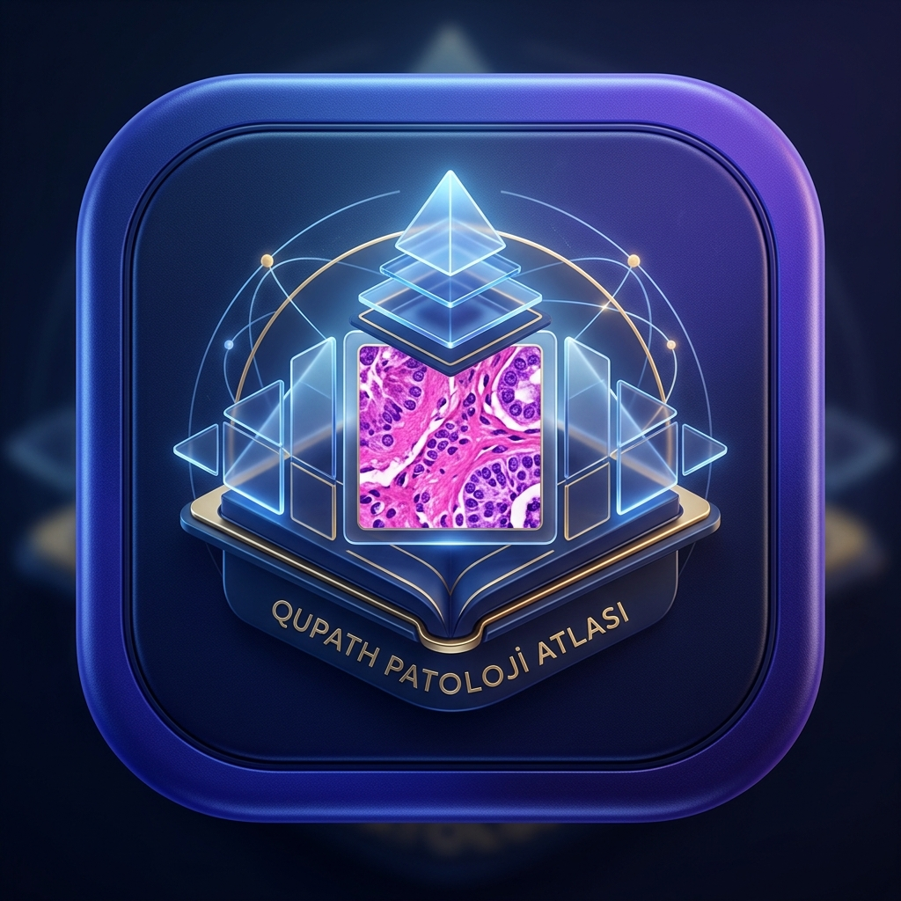
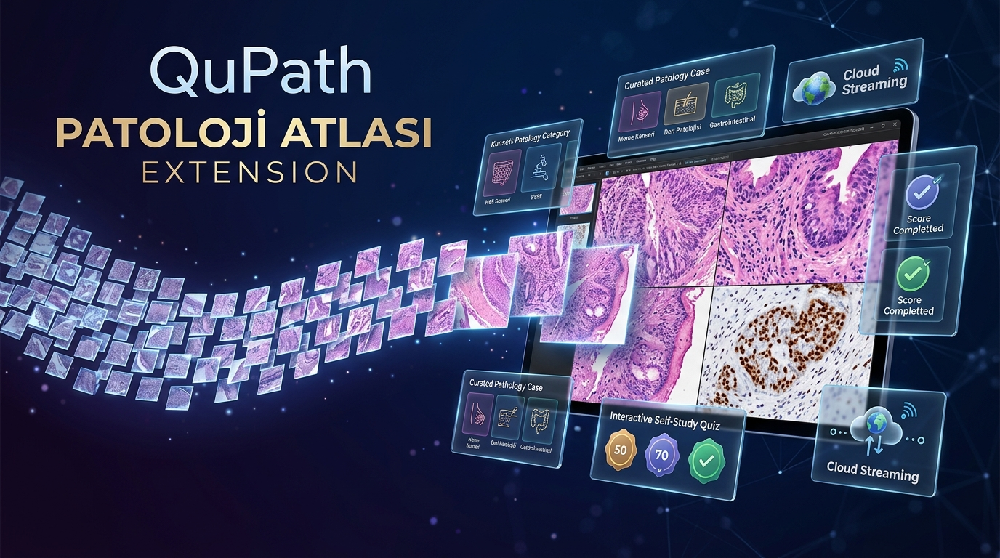
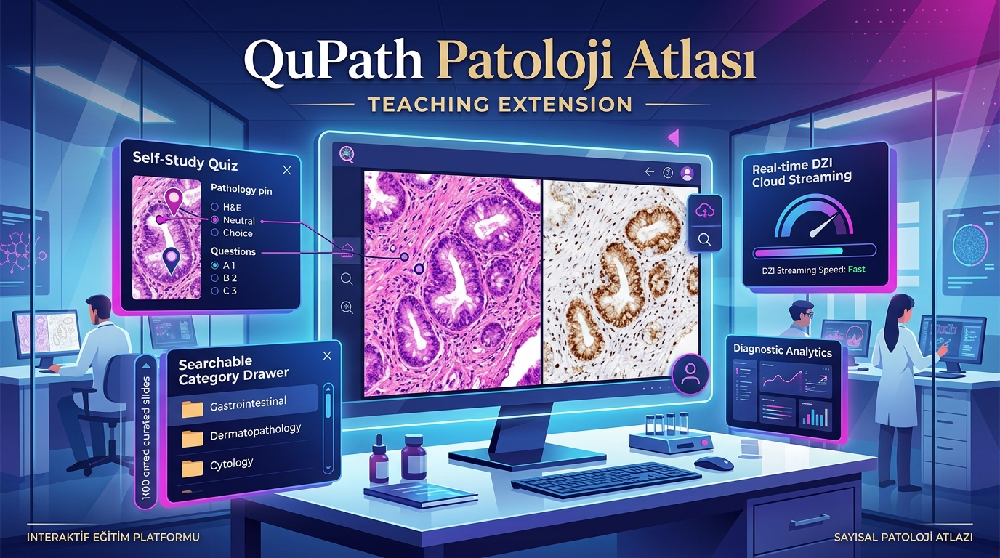

# QuPath Extensions Promotional Branding Kit

> **Current Patoloji Atlası assets:** See [assets/brand/README.md](assets/brand/README.md) for the website image pack, scalable icon, favicons, and extension icon. The JPGs described below are the earlier promotional set.

Professional visual asset suite created for the **QuPath Workshop Extension** and **QuPath Atlas Extension**. Designed specifically for personal website integration, portfolio cards, and social media promotion across LinkedIn, X (Twitter), and academic presentations.

---

## 1. QuPath Workshop Extension (Patologlar için QuPath)

> [!NOTE]
> **Core Theme:** Computational pathology, hands-on training, automated AI cell detection (StarDist/Cellpose), Groovy scripting workflows, and biomarker quantification.

### Visual Assets

The workshop JPGs are committed in [`sbalci/qupath-workshop/assets/`](https://github.com/sbalci/qupath-workshop/tree/main/assets), not in this Atlas repository. The previews below load those committed files.

#### App Icon (1:1)


- **Committed file / download:** [workshop-extension-icon.jpg](https://github.com/sbalci/qupath-workshop/blob/main/assets/workshop-extension-icon.jpg)
- **Aspect Ratio:** 1:1 (Square)
- **Best For:** Website navigation icon, app launcher badge, portfolio avatar, favicon.

---

#### Wide Banner (16:9)


- **Committed file / download:** [workshop-extension-banner.jpg](https://github.com/sbalci/qupath-workshop/blob/main/assets/workshop-extension-banner.jpg)
- **Aspect Ratio:** 16:9 (Widescreen)
- **Best For:** Website hero banner, Twitter/X header, LinkedIn page cover, presentation opening slide.

---

#### Promotional / Feature Image (16:9)


- **Committed file / download:** [workshop-extension-promo.jpg](https://github.com/sbalci/qupath-workshop/blob/main/assets/workshop-extension-promo.jpg)
- **Aspect Ratio:** 16:9
- **Best For:** Social media feed posts (LinkedIn / X), blog post feature image, project showcase card.

---

## 2. QuPath Atlas Extension (Patoloji Atlası)

> [!NOTE]
> **Core Theme:** Streaming whole-slide images (DZI Deep Zoom) tile-by-tile into QuPath, open histopathology teaching library (patolojiatlasi.com / histopathologyatlas.com), multi-stain comparison (H&E, IHC, special stains), and interactive self-study quizzes.

### Visual Assets

#### App Icon (1:1)


- **Committed file / download:** [atlas-extension-icon.jpg](assets/atlas-extension-icon.jpg)
- **Aspect Ratio:** 1:1 (Square)
- **Best For:** Website menu icon, repository badge, application avatar, browser extension button.

---

#### Wide Banner (16:9)


- **Committed file / download:** [atlas-extension-banner.jpg](assets/atlas-extension-banner.jpg)
- **Aspect Ratio:** 16:9 (Widescreen)
- **Best For:** Website hero header, social media cover banner, course syllabus header, conference poster banner.

---

#### Promotional / Feature Image (16:9)


- **Committed file / download:** [atlas-extension-promo.jpg](assets/atlas-extension-promo.jpg)
- **Aspect Ratio:** 16:9
- **Best For:** LinkedIn update, X announcement thread, digital pathology seminar announcement, educational tutorials.

---

## 3. Asset Specifications & File Matrix

Atlas links are relative to this repository. Workshop links point to the separate workshop repository. Open a committed-file link and use GitHub’s **Download raw file** control (or open the raw image and save it) to download the original JPG.

| Asset | Project | Ratio | Committed Source | Recommended Usage |
| :--- | :--- | :---: | :--- | :--- |
| **Workshop Icon** | QuPath Workshop | 1:1 | [assets/workshop-extension-icon.jpg](https://github.com/sbalci/qupath-workshop/blob/main/assets/workshop-extension-icon.jpg) | Web badge, avatar, favicon |
| **Workshop Banner** | QuPath Workshop | 16:9 | [assets/workshop-extension-banner.jpg](https://github.com/sbalci/qupath-workshop/blob/main/assets/workshop-extension-banner.jpg) | Hero banner, header, deck title |
| **Workshop Promo** | QuPath Workshop | 16:9 | [assets/workshop-extension-promo.jpg](https://github.com/sbalci/qupath-workshop/blob/main/assets/workshop-extension-promo.jpg) | Social post, card thumbnail |
| **Atlas Icon** | Patoloji Atlası | 1:1 | [assets/atlas-extension-icon.jpg](assets/atlas-extension-icon.jpg) | Web badge, avatar, button |
| **Atlas Banner** | Patoloji Atlası | 16:9 | [assets/atlas-extension-banner.jpg](assets/atlas-extension-banner.jpg) | Hero banner, header, poster |
| **Atlas Promo** | Patoloji Atlası | 16:9 | [assets/atlas-extension-promo.jpg](assets/atlas-extension-promo.jpg) | Social post, feature article |

---

## 4. Personal Webpage Integration Snippets

### Modern HTML Card Component (for Personal Website)

Before using this snippet, copy the four banner/icon JPGs from the source links in the table above into your website's published `assets/` directory, preserving their filenames. The two promo JPGs are optional for other cards or social posts. A link or preview in this document does not copy a file into your website.

The `/assets/...` URLs below are deployment destinations relative to the website origin, not links to files already deployed there. For a site hosted under a subpath, adjust the URLs to include that site's base path. The Workshop Extension project link intentionally points to `qupath-extension-workshop`; its promotional images are stored in `qupath-workshop`.

For the newer Atlas mark, favicons, hero illustrations, and social card, see the [current visual asset pack and integration instructions](assets/brand/README.md). Copy any selected files into your website's static assets as described there. Its histology illustrations are generated artwork, not diagnostic case images; retain that distinction in captions and alt text.

```html
<!-- QuPath Workshop Extension Card -->
<div class="project-card">
  <div class="card-banner">
    
    
  </div>
  <div class="card-body">
    <h3>Patologlar için QuPath — Workshop Extension</h3>
    <p>Hands-on computational pathology workflows, AI cell segmentation, StarDist models, and batch scripting for pathologists.</p>
    <a href="https://github.com/sbalci/qupath-extension-workshop" class="btn btn-primary" target="_blank" rel="noopener">Explore Extension →</a>
  </div>
</div>

<!-- QuPath Atlas Extension Card -->
<div class="project-card">
  <div class="card-banner">
    
    
  </div>
  <div class="card-body">
    <h3>QuPath Patoloji Atlası — Streaming Teaching Extension</h3>
    <p>Stream hundreds of whole-slide images live from patolojiatlasi.com directly into QuPath with interactive quizzes and multi-stain cases.</p>
    <a href="https://github.com/sbalci/patolojiatlasi-QuPath" class="btn btn-primary" target="_blank" rel="noopener">Explore Extension →</a>
  </div>
</div>
```

---

## 5. Social Media Copy Templates

### For QuPath Workshop Extension

#### LinkedIn / X (Twitter) - English
> 🔬 **Take your digital pathology analysis to the next level with QuPath!**
>
> Excited to share the **QuPath Workshop Extension** — built specifically for pathologists and researchers diving into computational pathology:
> 
> ⚡ One-click hands-on scripts for StarDist & Cellpose segmentation  
> 📊 Automated biomarker scoring & tissue classification  
> 🛠️ Batch processing workflows with zero overhead  
> 
> Check out the repository & guides: [Link]
> 
> #DigitalPathology #QuPath #PathologyAI #ComputationalPathology #Bioimaging

#### LinkedIn / X (Twitter) - Türkçe
> 🔬 **Patologlar için QuPath Atölyesi & Eklentisi**
>
> Dijital patolojide yapay zekâ ve otomatik hücre analizi iş akışlarını kolaylaştıran QuPath eklentimiz hazır:
> 
> 🔹 StarDist ve derin öğrenme ile hücre bölütleme  
> 🔹 Doku sınıflandırma ve biyobelirteç skorlaması  
> 🔹 Tek tıkla çalıştırılabilen Groovy otomasyon betikleri  
> 
> Detaylar ve indirme bağlantısı: [Link]
> 
> #DijitalPatoloji #QuPath #YapayZeka #Patoloji #TıpBilişimi

---

### For QuPath Patoloji Atlası Extension

#### LinkedIn / X (Twitter) - English
> 🌐 **Stream hundreds of whole-slide images directly into QuPath — no download required!**
> 
> Introducing the **QuPath Patoloji Atlası (Histopathology Atlas) Extension**:
> 
> 🚀 Tile-by-tile Deep Zoom (DZI) streaming straight from patolojiatlasi.com  
> 📚 Comprehensive teaching cases across organs (H&E, IHC, special stains)  
> 🧩 Interactive self-study quizzes & guided slide tours  
> 
> Install with one click in QuPath: [Link]
> 
> #Histopathology #DigitalPathology #MedicalEducation #QuPath #OpenScience

#### LinkedIn / X (Twitter) - Türkçe
> 🌐 **Patoloji Atlası artık doğrudan QuPath içinde!**
> 
> Yüzlerce tüm slayt görüntüsünü (WSI) bilgisayarınıza indirmeden, Deep Zoom akışı ile anında QuPath'te inceleyin:
> 
> 📌 Canlı slayt akışı (H&E, İHK ve özel boyalar)  
> 📌 Vaka koleksiyonları ve organ sistemlerine göre arama  
> 📌 Sınav & interaktif quiz modülü ile kendi kendine çalışma  
> 
> Hemen denemek için: [Link]
> 
> #PatolojiAtlası #DijitalPatoloji #TıpEğitimi #QuPath
